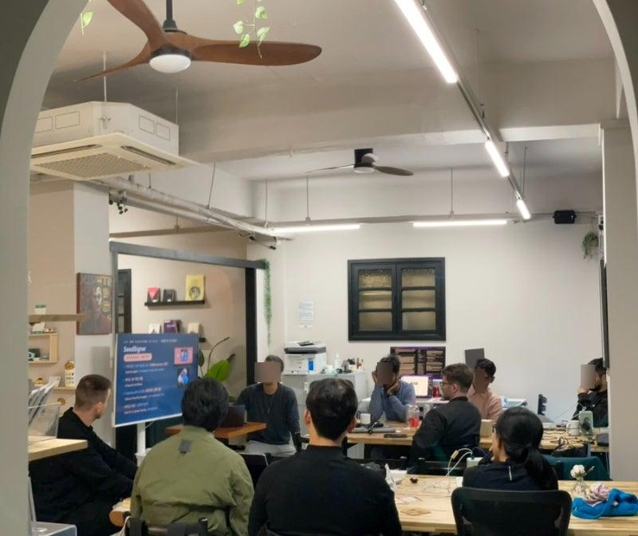
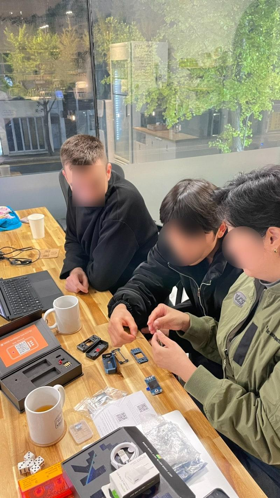
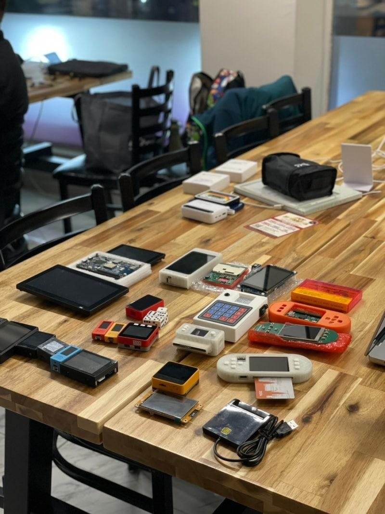
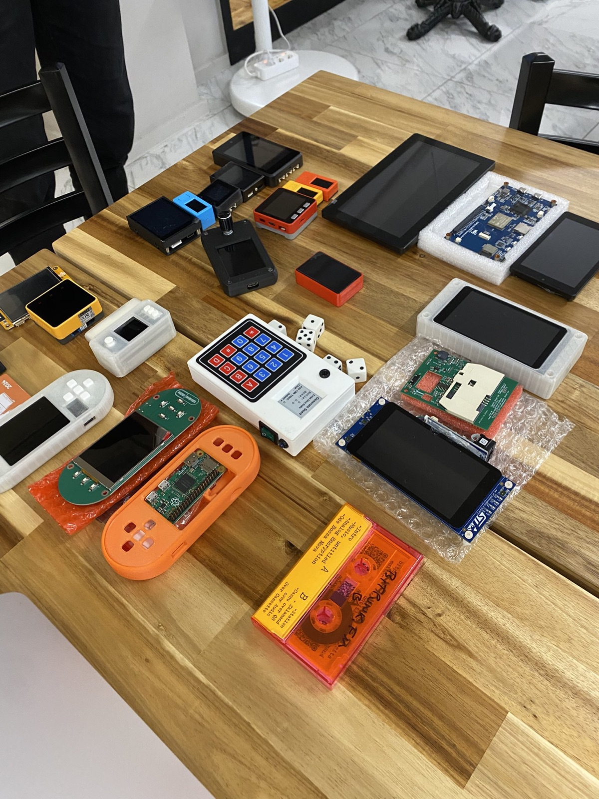
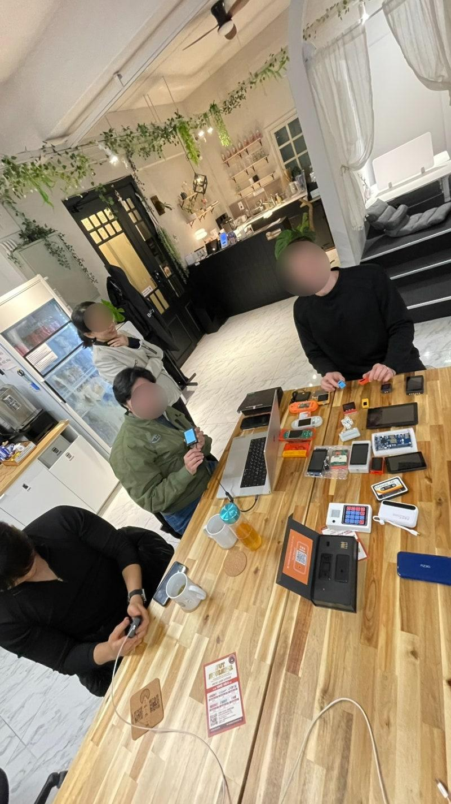
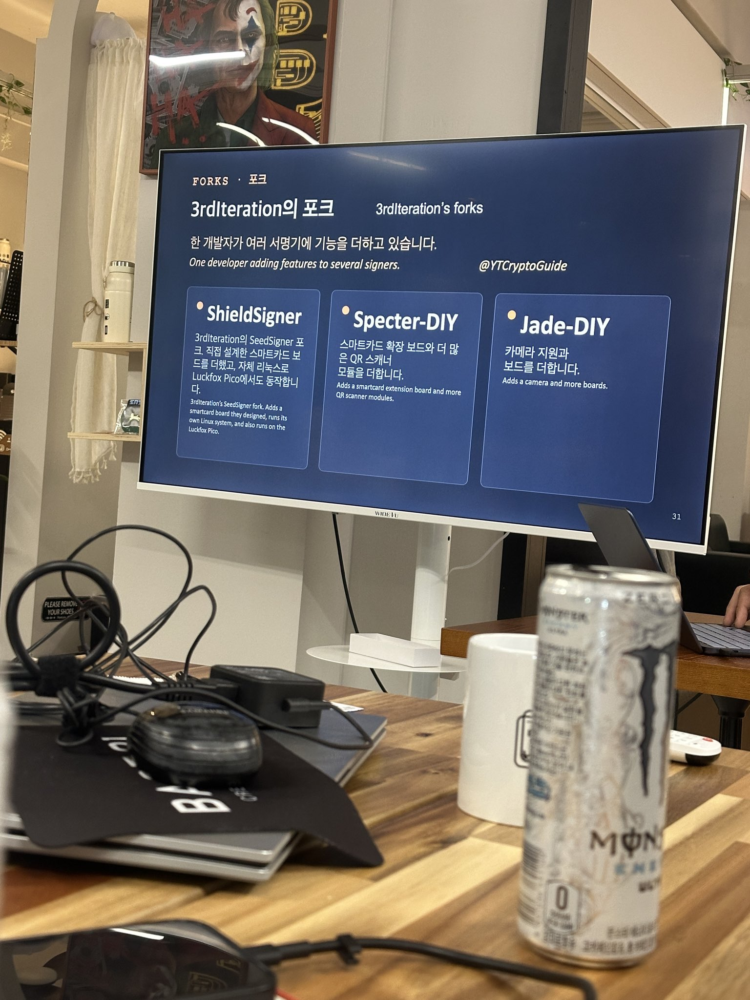

# 🇰🇷 Busan, November 2026

🛠️ Bitcoin DIY, a free hands on workshop with open source DIY signing
devices, with Bitcoin Pusan at Base21 in Busan on 11 November 2026.

🐦 [Bitcoin Pusan's announcement on X](https://x.com/bitcoinpusan/status/2120028862780502307)
· 🐦 [Post about the workshop on X](https://x.com/nldd21/status/2120284995906625693)
· 🐦 [Post about the workshop on X](https://x.com/eriklocalhost/status/2120444734267080770)
· 🐦 [An attendee's post on X](https://x.com/Stark21m/status/2120807523670188301)
· 🐦 [Another attendee's post on X](https://x.com/Bigmac2gue/status/2120792191140511980)
