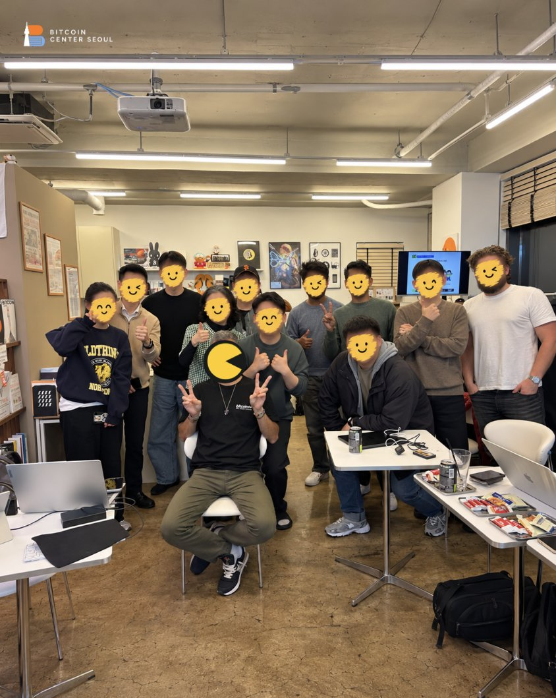
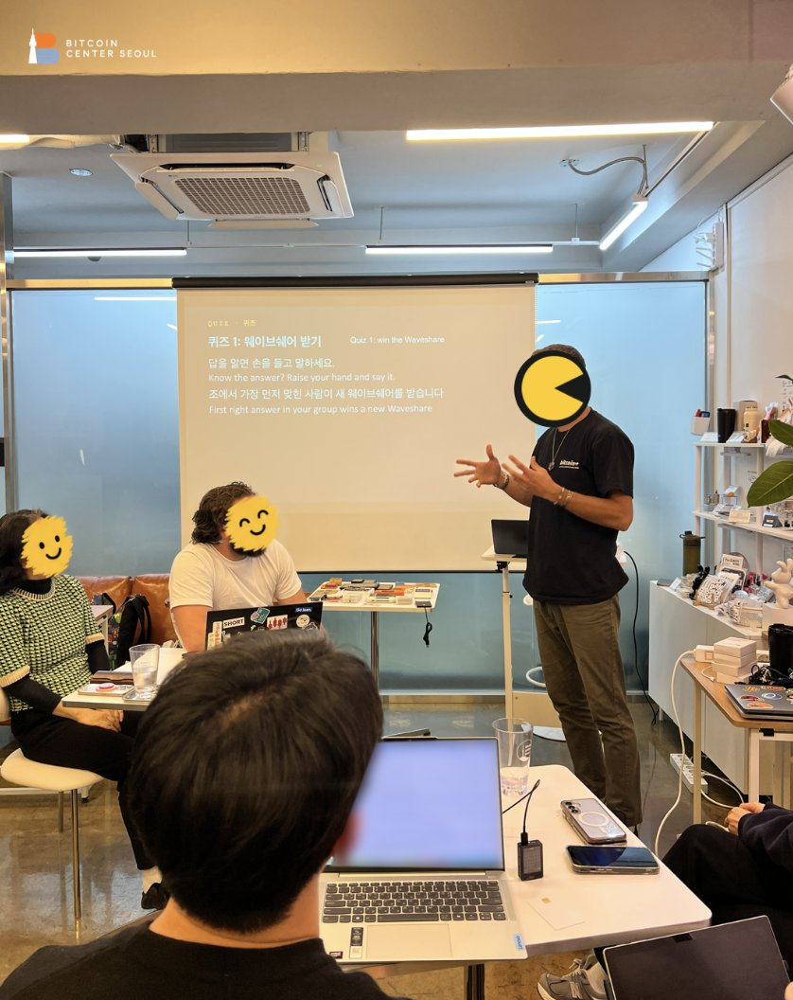
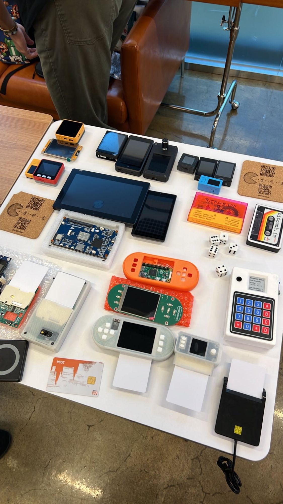
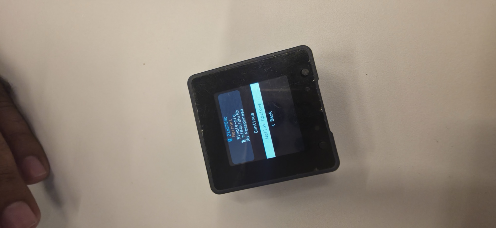
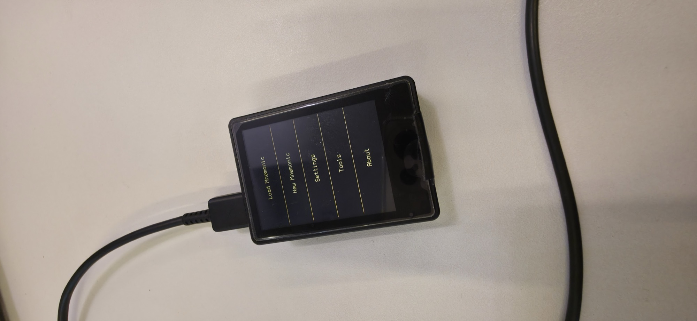
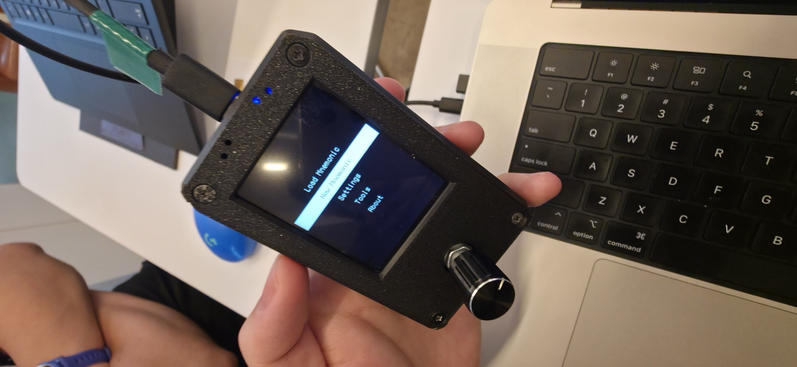
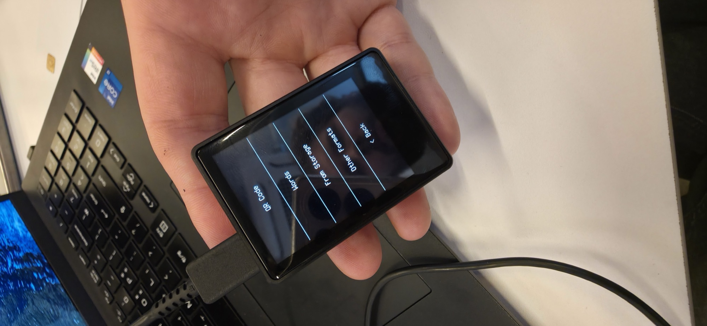
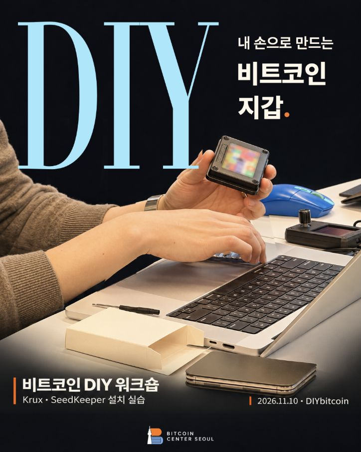

# 🇰🇷 Bitcoin Center Seoul, November 2026

🛠️ Build Your Own Bitcoin Signing Device, a hands on workshop at
Bitcoin Center Seoul on 10 November 2026: why it matters that signers
don't all share the same code, then attendees installed Krux on blank
devices and SeedKeeper on blank javacards, with a quiz to win a
Waveshare board.

📅 [Event page](https://bitcoincenterseoul.com/en/programs/bitcoin-developer-hands-on-workshop)
· 🐦 [Post about the workshop on X](https://x.com/dongguri2100/status/2120089739114299825)
· 🐦 [Bitcoin Center Seoul's post on X](https://x.com/BtcCtrSeoul/status/2120691631896863075)
